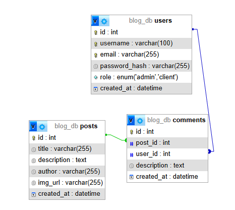

# ✍️ Блог — многопользовательская платформа с админ-панелью

**Период:** февраль–март 2026 · НГУЭУ

**🟢 Живой код:** [github.com/Allstenna/blog_proj](https://github.com/Allstenna/blog_proj)

**🎬 Видео-обзор:** [смотреть](https://drive.google.com/file/d/1E69pqjrknYXyaWZGvKYIClyksyyRVzGi/view)

---

## 📌 О проекте

Веб-ресурс с полным циклом работы с контентом: лента постов, комментарии без перезагрузки страницы, закрытая админка. Единственный проект портфолио с **публичным кодом** — можно открыть и посмотреть вживую.

**Стек:** PHP · MySQL · JavaScript (AJAX/`fetch`) · CSS (Flexbox, медиа-запросы) · OpenServer · phpMyAdmin

## 🗄️ База данных (3 таблицы)

`users` · `posts` · `comments`

Ключевое для тестирования — `ON DELETE CASCADE`: при удалении поста
комментарии к нему удаляются автоматически. Отдельный кейс на проверку
целостности.

## ⚙️ Модули

1. **Аутентификация** — регистрация с валидацией на сервере (уникальность email, пароль ≥ 6 символов, совпадение паролей), хеширование `password_hash()`/`password_verify()`, сессии с записью `user_id` и `role`.
2. **Лента постов** — сортировка по дате, превью 200 символов, пагинация через `LIMIT/OFFSET` + JS.
3. **Страница поста** — комментарии, AJAX-добавление без перезагрузки (`fetch`), лайки.
4. **Админ-панель** — CRUD постов, загрузка изображений в `uploads/`, модерация и удаление комментариев, каскадная очистка.

## 🔒 Безопасность и контроль доступа

- PDO (prepared statements) — защита от SQL-инъекций.
- `htmlspecialchars()` — защита от XSS при выводе постов/комментариев.
- Ролевая модель: папка `admin/` закрыта проверкой сессии в начале каждого файла; попытка клиента пройти по URL → редирект на **404**.
- Загрузка файлов: проверка расширения (только JPEG/PNG), генерация уникального имени (защита от перезаписи и подмены).
- `config/db.php` вынесена за пределы `public_html`.

## 📱 Адаптивность

Медиа-запросы под планшеты и смартфоны, Flexbox-компоновка, гамбургер-меню, `box-sizing: border-box`. Отдельная страница 404.

## 🧪 QA-взгляд на проект

- **AJAX-комментарий:** отправка без перезагрузки, появление в начале списка, поведение при пустом вводе и при отсутствии авторизации (сообщение «войдите»).
- **Пагинация:** корректность LIMIT/OFFSET, крайние страницы, пустая выдача.
- **Каскадное удаление:** удалить пост → проверить исчезновение комментариев в БД и на фронте.
- **Загрузка файла:** jpg/png ок, .php/.exe отклоняется, дубликаты имен.
- **Доступ по ролям:** клиент лезет в `admin/posts.php` → 404; админ видит все.

## 📎 Материалы

- 💻 [Исходный код](https://github.com/Allstenna/blog_proj)
- 📄 [Отчет о практике (PDF)](https://drive.google.com/file/d/1ezpPJ-LMlXG6zl8h2q4PNfsMCoG6uIo8/view?usp=sharing)
- 🎨 [Дизайн в Figma](https://www.figma.com/design/Pv5bngQlsVDw3v08qQ1ji7/Blog?t=spZnrNG0Zr8iCiuo-1)