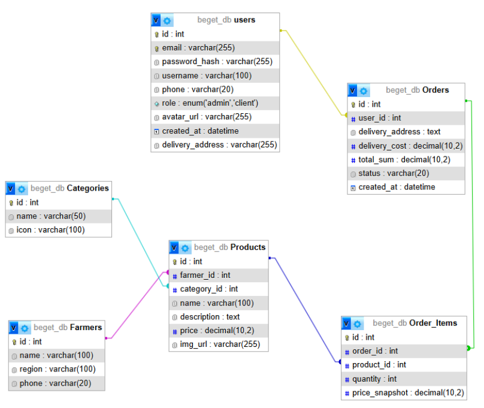
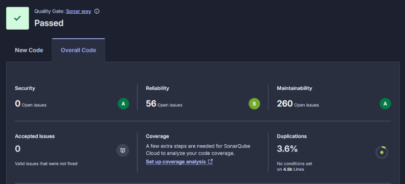

# 🛒 FarmWare — интернет-магазин фермерских продуктов

**Период:** январь–апрель 2026 · НГУЭУ, СПО 09.02.07

**🟢 Живой код:** [github.com/Allstenna/shopFarmWare](https://github.com/Allstenna/shopFarmWare)

**Ключевая фишка:** фильтр по региону производства + динамический расчёт доставки в корзине

## 📌 О проекте

Площадка прямых продаж местной сельхозпродукции. Уникальность — в прозрачности: пользователь видит, из какого региона товар, и стоимость доставки считается автоматически от суммы заказа (без скрытых платежей и звонков менеджеру, как у конкурентов).

**Стек:** PHP · MySQL · HTML/CSS · JavaScript (без фреймворков) · Bootstrap 5 (только модалка) · phpMyAdmin · OpenServer · draw.io · SonarQube

## 🏗️ Архитектура

- Паттерн **MVC** с изоляцией зон: `public_html` (публичная, точка входа `index.php` + `.htaccess`) и `app` (серверная логика, скрыта от внешнего доступа).
- Разделение ответственности: `Controllers` (в т.ч. `admin/`), `Models`, `Views`.

## 🗄️ База данных (6 таблиц)

`users` · `Categories` · `Farmers` · `Products` · `Orders` · `Order_Items`

Связь `Products → Farmers` через `farmer_id` обеспечивает фильтрацию по региону.
Поле `price_snapshot` в `Order_Items` фиксирует цену на момент заказа —
классический кейс проверки целостности данных при тестировании.

## ⚙️ Реализованный функционал

- Аутентификация: формы, сессии, хеширование паролей, RBAC (клиент/админ).
- Каталог с одновременной фильтрацией по категориям **и** регионам (данные из БД).
- Корзина с пересчетом доставки от общей суммы.
- Личный кабинет с защитой от просмотра чужих данных (**Anti-IDOR**) и подделки запросов (**Anti-CSRF**).
- CRUD + пагинация (AJAX-обновление без перезагрузки).

## 🔒 Информационная безопасность

| Угроза | Механизм защиты |
|--------|-----------------|
| SQL-инъекции | PDO, prepared statements (данные отдельно от запроса) |
| XSS | экранирование через `htmlspecialchars()` |
| CSRF | синхронизирующие токены в формах и AJAX |
| IDOR | проверка прав на сервере при доступе к чужим данным |

Проведен статический анализ кода в **SonarQube** по критериям: безопасность, надежность, поддерживаемость.

## 🧪 QA-взгляд на проект

Что я бы тестировала в первую очередь (и тестировала на практике):
- **Граничные значения доставки:** сумма = порогу, сумма = 0, пустая корзина.
- **Комбинация фильтров** регион+категория → пустая выдача, сброс фильтров.
- **Пагинация** при нечётном количестве товаров, переход на несуществующую страницу.
- **RBAC:** попытка клиента открыть админ-URL → должен вернуть 404/редирект.
- **Загрузка файлов:** неверный тип, перезапись, большой размер.
- **Целостность `price_snapshot`:** изменение цены товара после оформления заказа не должно менять сумму в старом заказе.

## 📎 Материалы

- 📄 [Пояснительная записка (PDF)](https://drive.google.com/file/d/1Y2jiHZIUtMH3JOJHa1SGUHebYhgVX0WL/view?usp=sharing)
- 🎨 [Дизайн в Figma](https://www.figma.com/design/NxfjzHDKnB4eBuNx2l4eaT/FarmWare?t=spZnrNG0Zr8iCiuo-1)