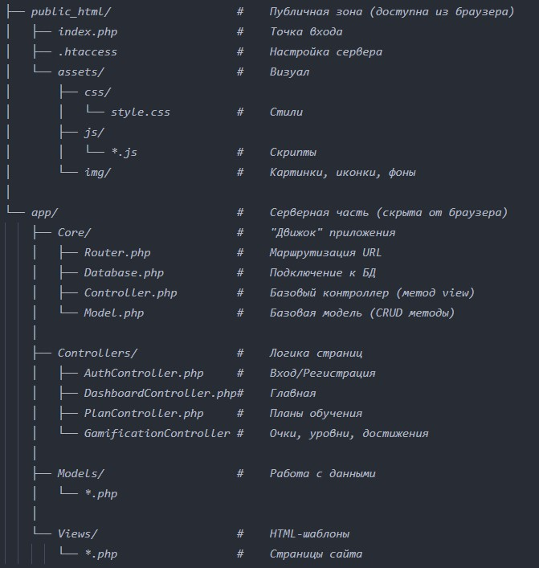
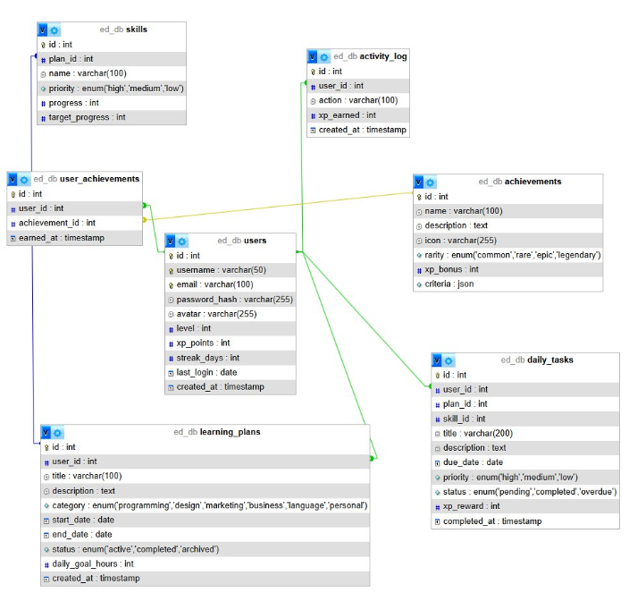
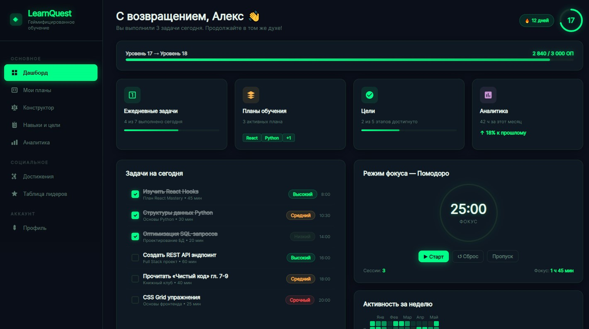
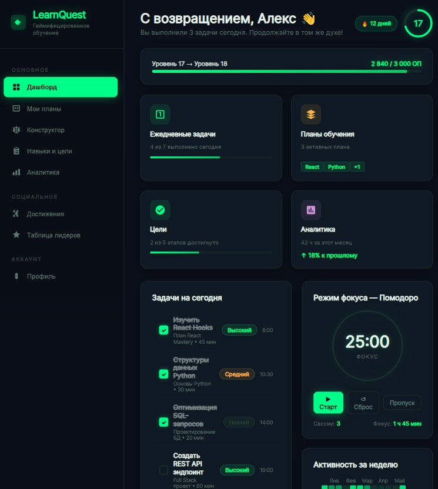
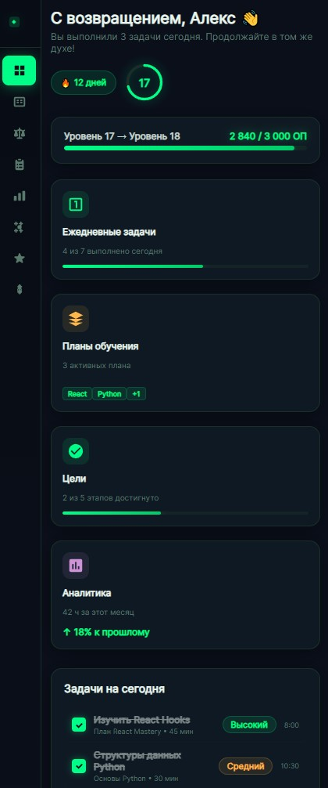

# 🎮 Платформа геймификации обучения — ВКР

**Период:** апрель–июнь 2026 · НГУЭУ

**Цель:** повысить мотивацию и вовлеченность через прозрачные игровые механики

---

## 📌 О проекте

Веб-платформа персонального планирования обучения с системой опыта, уровней, достижений и аналитики прогресса. Архитектурный принцип — «осознанная минималистичность»: чистый PHP по MVC вместо тяжёлых фреймворков, что даёт полный контроль над безопасностью и производительностью.

**Стек:** PHP (MVC) · MySQL · phpMyAdmin · HTML/CSS/JS (Pomodoro, прогресс-бары, heatmap) · OpenServer

## 🏗️ Архитектура

- `public_html` — `index.php` (точка входа/маршрутизатор), `.htaccess`, `assets/`.
- `app` (закрытая зона) — `Core/` (роутинг, БД, базовые классы), `Controllers/`, `Models/`, `Views/`.
- Поток: запрос → `.htaccess` → `index.php` → ядро → контроллер → модель → представление.

## 🗄️ База данных (7 таблиц)

`users` (прогресс: `level`, `xp_points`, `streak_days`) · `learning_plans` · `skills` · `daily_tasks` · `achievements` · `user_achievements` · `activity_log` (неизменяемый журнал событий).

## ⚙️ Модули интерфейса

- **Дашборд** — задачи на день, таймер Pomodoro, статистика, дедлайны.
- **Мои планы** — конструктор в 4 этапа, прогресс-бары, статусы (активные/завершённые/архив).
- **Навыки и цели** — навыки из планов, долгосрочные цели с подцелями.
- **Аналитика** — статкарты (XP, часы, задачи, серии), тепловая карта активности за 12 мес.
- **Достижения** — 5 степеней редкости, индикаторы прогресса.
- **Таблица лидеров** — топ-3, фильтры (глобальный/неделя/день), позиция текущего пользователя.
- **Профиль** — метрики, лента активности, вкладки.

## 🔒 Информационная безопасность (по OWASP Top 10)

| Угроза | Реализация |
|--------|-----------|
| SQL-инъекции | PDO + prepared statements, **принудительно отключена имитация** готовых запросов на уровне драйвера |
| XSS | `htmlspecialchars()` с UTF-8, заголовок **CSP**, `filter_var()` для GET/POST |
| Сессии | хеширование паролей, управление сессиями, разграничение прав |

## 📱 Тестирование адаптивности

Проверено на целевых разрешениях без критических дефектов вёрстки:
- **1440 px** — боковая панель зафиксирована, 3-колоночная сетка задач, полная аналитика.
- **768 px** — сетка в 2 колонки, компактная панель метрик.
- **425 px** — свёрнутое меню, элементы ≥ 44×44 px, одноколоночная прокрутка.

Реализация — медиа-запросы `@media`, двумерные grid-сетки, относительные единицы.

## 🧪 QA-взгляд на проект

Самый богатый на логику проект — раздолье для тест-дизайна:
- **Начисление XP:** граничные значения, накопление, сброс серии дней.
- **Конструктор плана:** валидация каждого из 4 шагов, пропуск обязательных полей.
- **Heatmap:** корректность агрегации за 12 месяцев, пустые периоды.
- **Лидерборд:** сортировка при равных очках, позиция текущего пользователя.
- **Безопасность:** попытка XSS в названии плана, SQLi через URL-параметры.

## 📎 Материалы

- 📄 [Дипломный проект (PDF)](https://drive.google.com/file/d/1Sazsr7iLgXaoaTp1MtUzdTv21OZJk42Y/view?usp=sharing)
- 🎨 [Дизайн в Figma](https://www.figma.com/design/MZiJiEH2WUmMBi6zizqjhs/Untitled?t=spZnrNG0Zr8iCiuo-1)