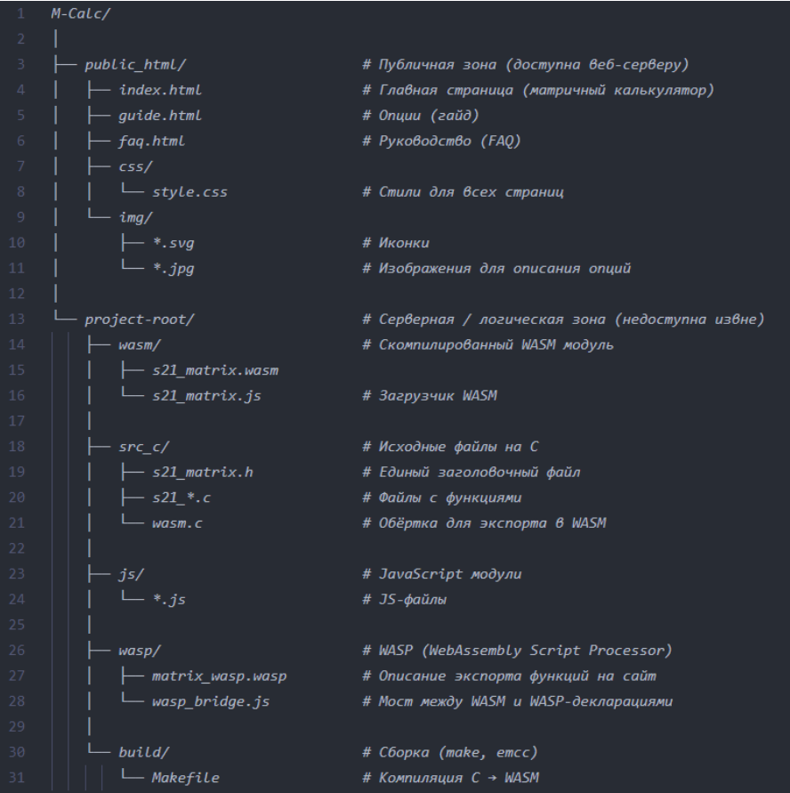
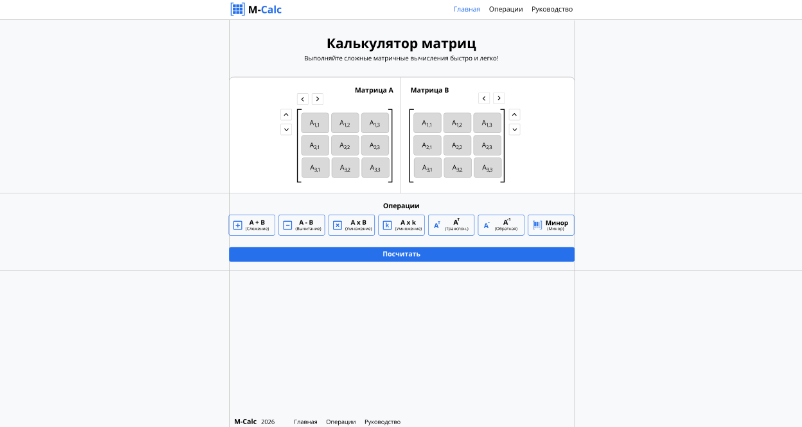
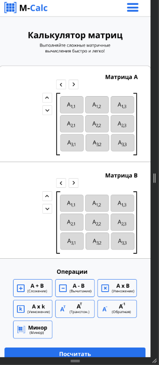

# 🧮 M-Calc — матричный веб-калькулятор на C + WebAssembly

**Период:** март–апрель 2026

**Особенность:** вычислительное ядро на **чистом C**, скомпилированное в **WebAssembly**

---

## 📌 О проекте

Быстрый калькулятор матриц в браузере. Решение против конкурентов: онлайн-сервисы на JS тормозят на больших матрицах и неточны с `double`, а библиотеки (NumPy/Eigen) требуют терминала и навыков программирования. Здесь — скорость компилируемого C + удобство веб-интерфейса.

**Стек:** C · WebAssembly (Emscripten) · WASP-мост · JavaScript · HTML/CSS · Makefile

## 🏗️ Архитектура

- `public_html` — шаблоны (главная, «Операции», «Руководство»), `css/`, `img/`.
- `project-root` — WASM-модуль, исходники на C, JS-файлы, WASP-декларации, папка `build/`.
- Единый заголовочный файл: структура данных, константы, прототипы функций.
- `Makefile` — автоматизация сборки; Emscripten генерирует `.wasm` + `.js`.

## ⚙️ Функционал

**7 операций в 3 категориях:**
- Бинарные: сложение, вычитание, умножение (матрица × матрица).
- Унарные: транспонирование, обратная матрица, минор.
- Со скаляром: умножение матрицы на число.

Квадратные матрицы от 2×2 и выше (1×1 трактуется как число). Пустые ячейки = 0. Ошибки (недопустимые размеры, вырожденная матрица) → текстовое сообщение с причиной.

## ✅ Валидация и тестирование

- `matrix_validate.js` — проверка типов, количества строк/столбцов, значений (в т.ч. `NaN`).
- Контроль загрузки WASM-модуля (по пути проекта / через `<script>`).
- Проведено **модульное и интеграционное** тестирование.
- Тестирование адаптивности на целевых разрешениях: **425 px** (бургер-меню) и **1920 px** (центрирование Flexbox).

## 🧪 QA-взгляд на проект

Это самый «математический» проект — идеальная база для техники **граничных значений** и **классов эквивалентности**:
- Матрица 1×1 → трактуется как число.
- Несовместимые размеры при умножении → сообщение об ошибке.
- Вырожденная матрица при поиске обратной → корректное сообщение.
- Ввод букв/спецсимволов в ячейку → блокировка.
- Отрицательные и дробные значения (разделитель — точка).
- Пустые ячейки → 0.

## 📎 Материалы

- 📄 [Отчет по практике (PDF)](https://drive.google.com/file/d/1f4qB8TUP00fXXOO1SMnmqt92WemRAQaT/view?usp=sharing)
- 🎨 [Дизайн в Figma](https://www.figma.com/design/AB3RszDHRQsFifyaCd4a3S/Matrix?node-id=0-1&t=spZnrNG0Zr8iCiuo-1)